# Evidências

Prints salvos em `docs/prints/`.

## 1. Preparação

Geração da chave SSH, consulta do IP público e criação do bucket para o state do Terraform. O print mostra duas tentativas com erro antes da criação do bucket

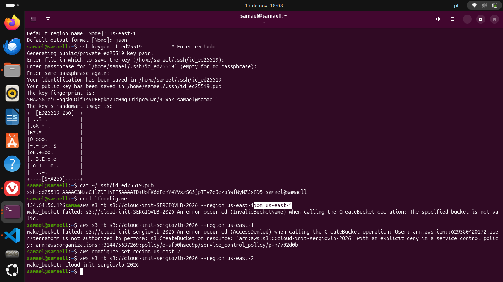

Criação do `terraform.tfvars` com a chave pública e o IP liberado para SSH. O arquivo não é enviado ao repositório (`.gitignore`).

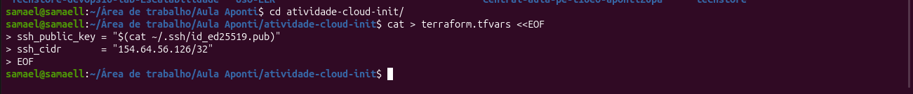

## 2. Validação e plano (local)

Primeira execução: `init` concluído, `fmt -check` apontando o `terraform.tfvars` e `validate` com erro no nome do security group.

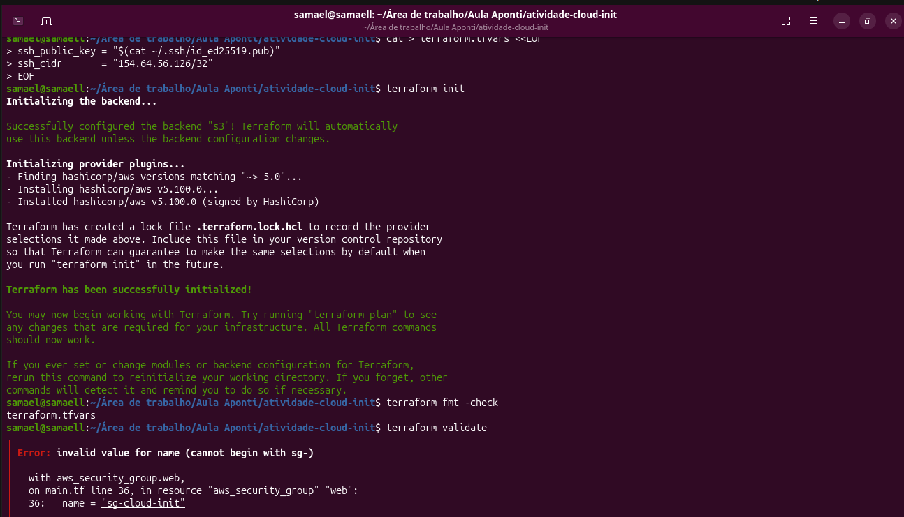

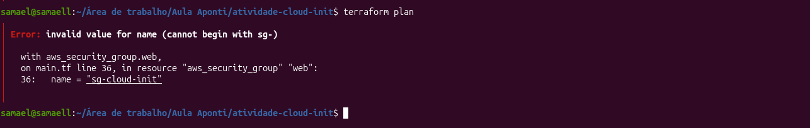

Após as correções, `fmt -check` sem pendências e `validate` com sucesso.

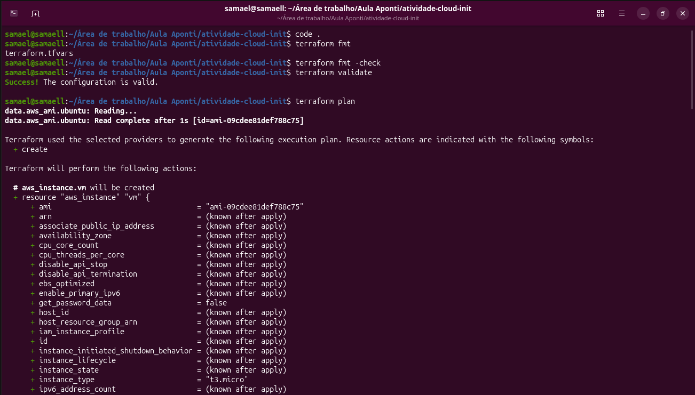

Plano de execução: criação de 3 recursos = key pair, security group e instância `t3.micro` com Ubuntu 24.04. A AMI é apenas consultada (`data source`).

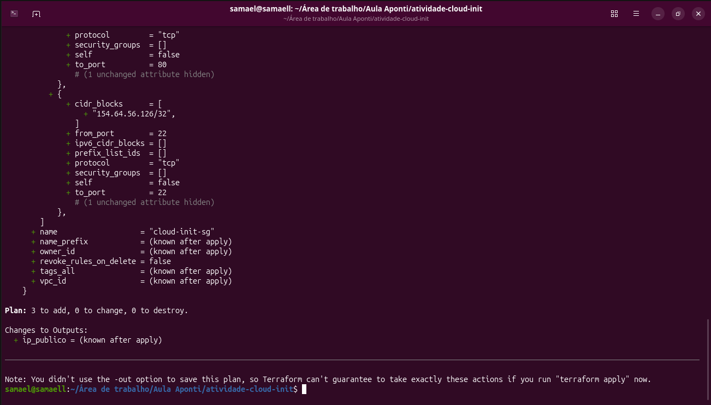

## 3. Pipeline executada

Execução manual concluída com sucesso: jobs `plan` e `apply` e aprovação no environment `producao`.

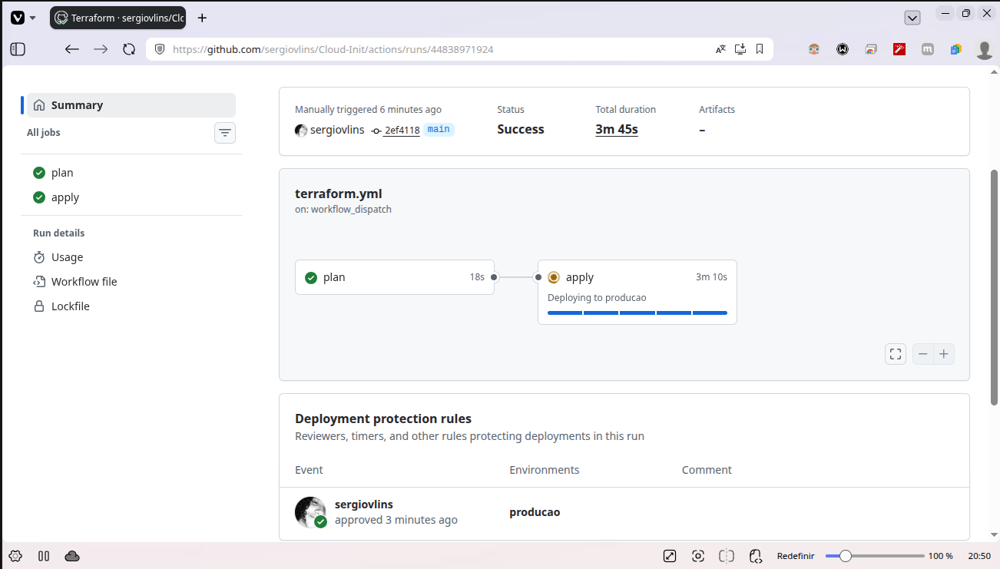

Etapas fmt, init, validate e plan do job `plan`.

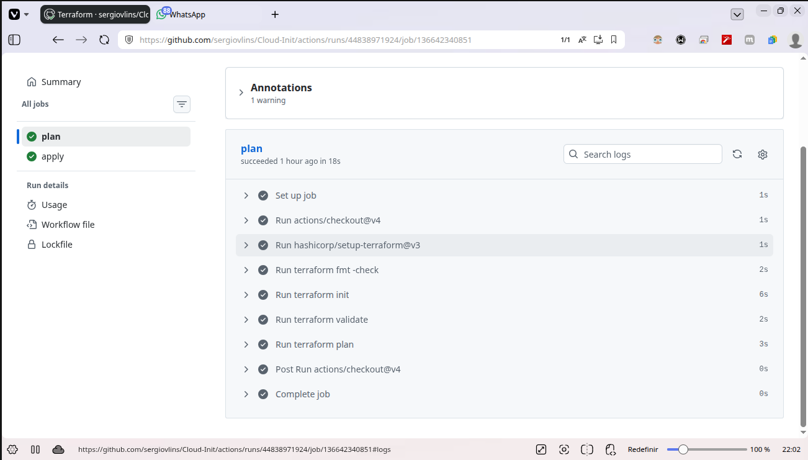

Saída do job `apply` com o IP público.

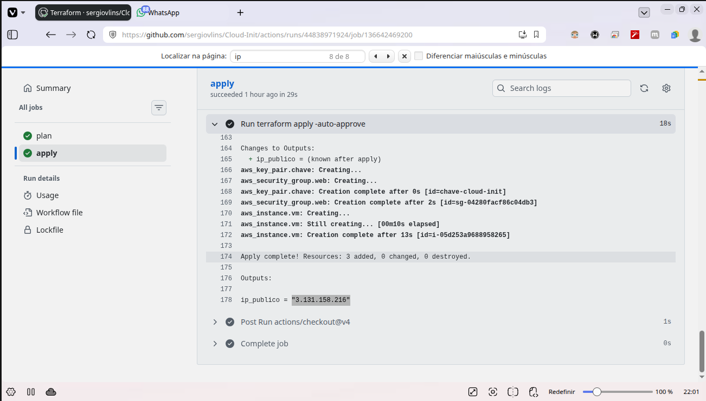

## 4. Infraestrutura provisionada

Instância `vm-cloud-init` em execução no console EC2 (us-east-2), com 3/3 verificações aprovadas.

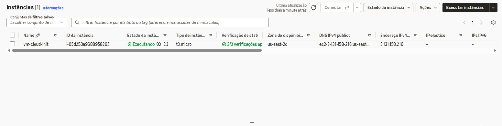

Acesso à VM por SSH com a chave cadastrada pelo Terraform.

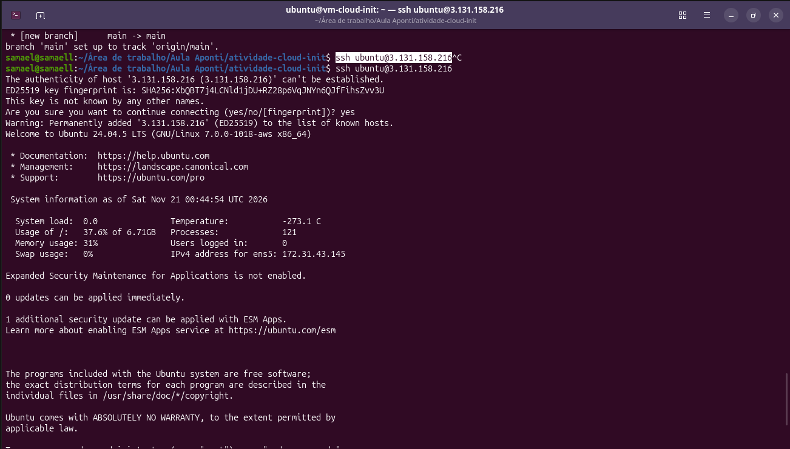

## 5. Cloud-Init concluído

```bash
cloud-init status --long
hostnamectl
tail -n 5 /var/log/cloud-init-output.log
```

Status `done` sem erros, hostname `vm-cloud-init` e mensagem final do Cloud-Init no log.

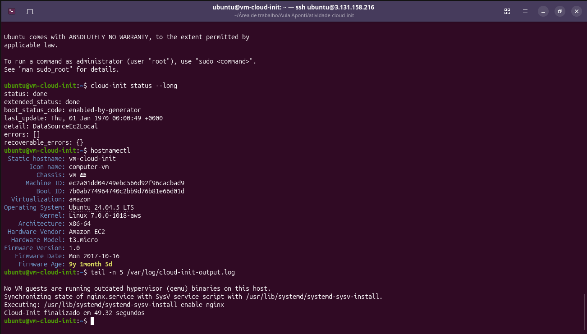

## 6. Docker e Nginx ativos

```bash
systemctl is-active docker nginx
docker --version && nginx -v
docker run --rm hello-world
```

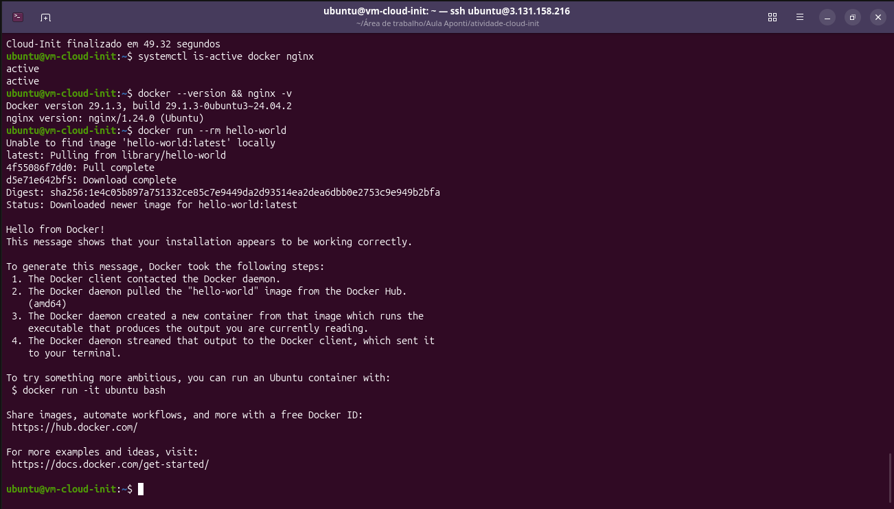

Primeira tentativa de acesso pelo navegador com erro por configurações do navegador, que forçava a conexão para HTTPS.

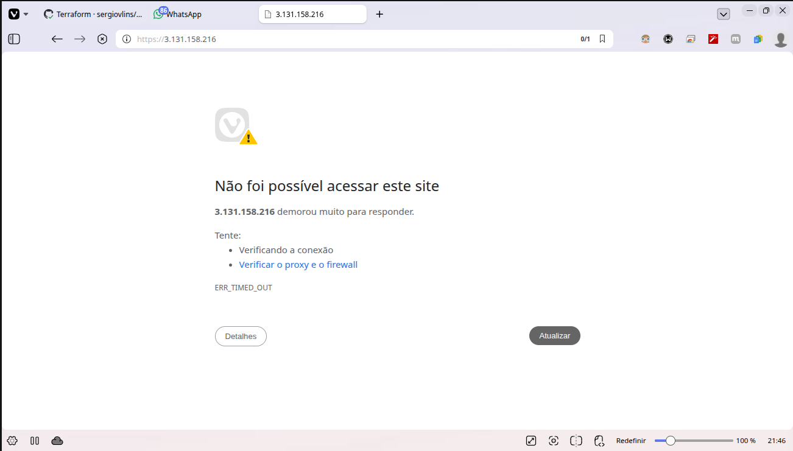

Página do Nginx acessada em `http://3.131.158.216`.

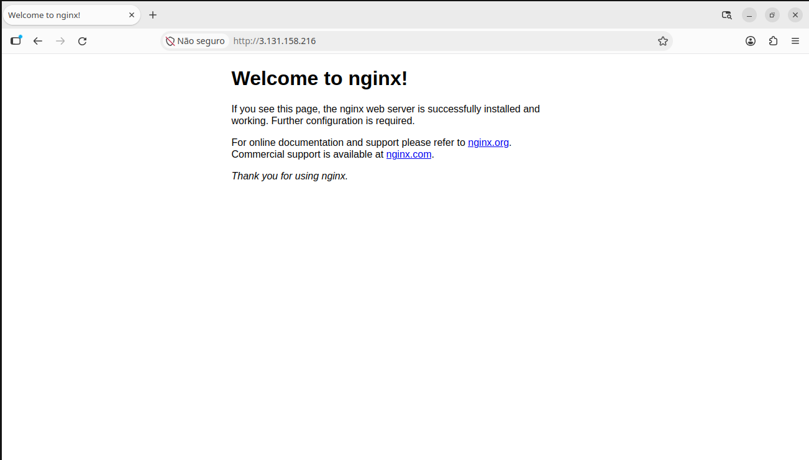

## 7. Recursos destruídos

Saída do `terraform destroy`.

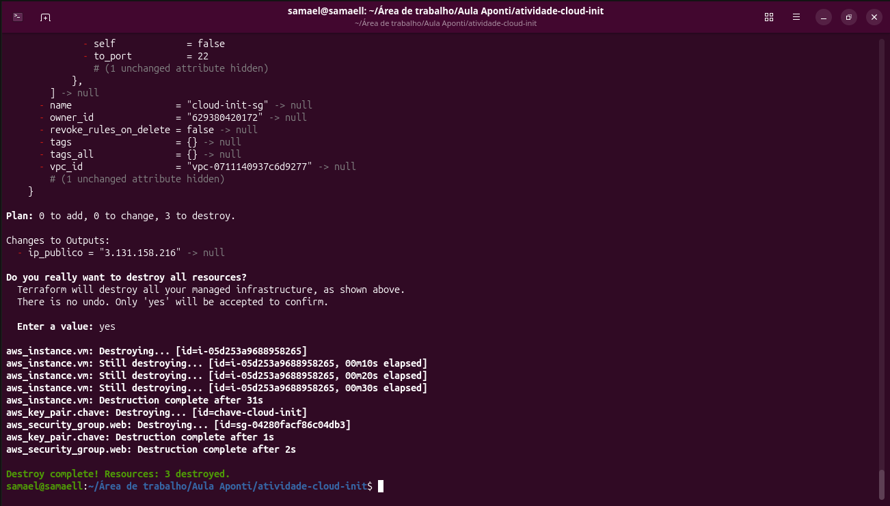
